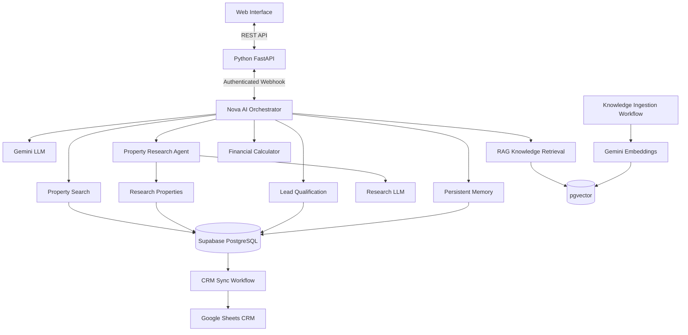

# Nova Estates AI

An AI-powered real estate automation platform combining multi-agent orchestration, retrieval-augmented generation (RAG), persistent conversation memory, automated lead qualification and CRM integration.

Built as an end-to-end demonstration of intelligent business automation for the real estate industry.

## Overview

Nova Estates AI enables prospective buyers to interact with an intelligent property advisor through a dedicated web application.

The system understands customer requirements, searches a property database, compares listings, answers agency-related questions and automatically qualifies leads based on their purchasing intent.

## Key Features

- **Multi-Agent Architecture:** Central AI orchestrator with a specialized property research agent.
- **Intelligent Property Search:** Database-backed filtering by location, budget, property type and number of bedrooms.
- **RAG Knowledge Base:** Semantic retrieval of agency policies and services using Gemini embeddings and pgvector.
- **Persistent Conversation Memory:** PostgreSQL-backed conversation history.
- **Automated Lead Qualification:** Customer profile extraction and database-driven lead scoring.
- **CRM Integration:** Automated Google Sheets synchronization with duplicate prevention and synchronization logs.
- **Financial Calculator:** Tool-based financial calculations.
- **REST API:** Python FastAPI backend connecting the web interface with n8n.
- **Web Interface:** Responsive property advisory website with conversational AI.
- **Security Controls:** Basic authentication, signed sessions, request validation, rate limiting and security headers.

## System Architecture



## Technology Stack

| Layer | Technology |
|---|---|
| Frontend | HTML5, CSS3, JavaScript |
| Backend | Python, FastAPI, HTTPX |
| Automation | n8n |
| AI Models | Google Gemini |
| Database | PostgreSQL, Supabase |
| Vector Search | pgvector, Gemini Embeddings |
| CRM | Google Sheets |
| Version Control | Git, GitHub |

## n8n Workflows

### AI Real Estate Agent

Handles customer conversations, property discovery, lead qualification, knowledge retrieval and delegated property research.

### Knowledge Base Ingestion

Processes demonstration agency documents, generates vector embeddings and stores them in Supabase for semantic retrieval.

### CRM Synchronization

Synchronizes qualified leads from PostgreSQL to Google Sheets using lead IDs for upsert operations. Includes synchronization success and failure logging.

## Lead Qualification

The system calculates a lead score using customer-provided information.

| Qualification Criteria | Maximum Points |
|---|---:|
| Budget | 25 |
| Preferred Location | 15 |
| Property Type | 10 |
| Bedrooms | 10 |
| Purchase Purpose | 15 |
| Purchase Timeline | 25 |
| Total | 100 |

Lead classification:

- Hot: 75–100 points
- Warm: 45–74 points
- Cold: Below 45 points

## Repository Structure

```
nova-estates-ai/
├── backend/
│   ├── main.py
│   ├── requirements.txt
│   └── .env.example
├── frontend/
│   ├── index.html
│   ├── style.css
│   └── app.js
├── workflows/
│   ├── ai-agent.json
│   ├── knowledge-ingestion.json
│   └── crm-sync.json
├── database/
│   ├── schema.sql
│   └── seed.sql
├── docs/
├── .gitignore
└── README.md
```

## Getting Started

### Prerequisites

- Python
- n8n instance
- Supabase project with PostgreSQL and pgvector
- Google Gemini API credentials
- Google Sheets account

### Backend Setup

```bash
cd backend
python -m venv .venv
source .venv/bin/activate
pip install -r requirements.txt
cp .env.example .env
```

Configure the required environment variables:

```env
N8N_CHAT_URL=your_n8n_chat_webhook_url
N8N_USERNAME=your_basic_auth_username
N8N_PASSWORD=your_basic_auth_password
SESSION_SECRET=your_random_session_secret
```

Start the application:

```bash
python -m uvicorn main:app --host 127.0.0.1 --port 8000
```

Open http://127.0.0.1:8000 in your browser.

### Database and Workflow Setup

1. Create a Supabase project and enable pgvector.
2. Review and restore the database schema using a compatible PostgreSQL client.
3. Import the demonstration property data.
4. Import the three n8n workflows.
5. Configure credentials and replace infrastructure placeholders.
6. Prepare the Google Sheets CRM.
7. Execute the Knowledge Base Ingestion workflow.
8. Publish the main AI agent workflow and configure its webhook URL in the backend.
9. Test CRM synchronization manually before enabling scheduled execution.

## API Endpoints

| Method | Endpoint | Description |
|---|---|---|
| GET | `/health` | Application health check |
| POST | `/api/chat` | Send a message to the AI advisor |
| POST | `/api/chat/reset` | Start a new conversation session |
| GET | `/docs` | Interactive API documentation |

## Example Use Cases

- Find a two-bedroom apartment in Dubai Marina within a specified budget.
- Compare properties across Dubai Marina and Business Bay.
- Ask about agency commissions and reservation policies.
- Calculate property down payments.
- Automatically qualify and synchronize potential buyers to a CRM.

## Security and Limitations

Credentials are configured outside the source code. Public workflow exports use infrastructure placeholders and require credential configuration after import.

This project is a demonstration MVP. Rate limiting is implemented locally in memory. Production deployment would require additional measures, including HTTPS, distributed rate limiting, stricter access controls and comprehensive security testing.

All property listings, prices and agency policies are fictional demonstration data.

## Project Purpose

Nova Estates AI demonstrates practical capabilities in:

- AI agent development
- Business process automation
- Multi-agent orchestration
- Retrieval-augmented generation
- API integration
- PostgreSQL database development
- CRM automation
- Full-stack application integration